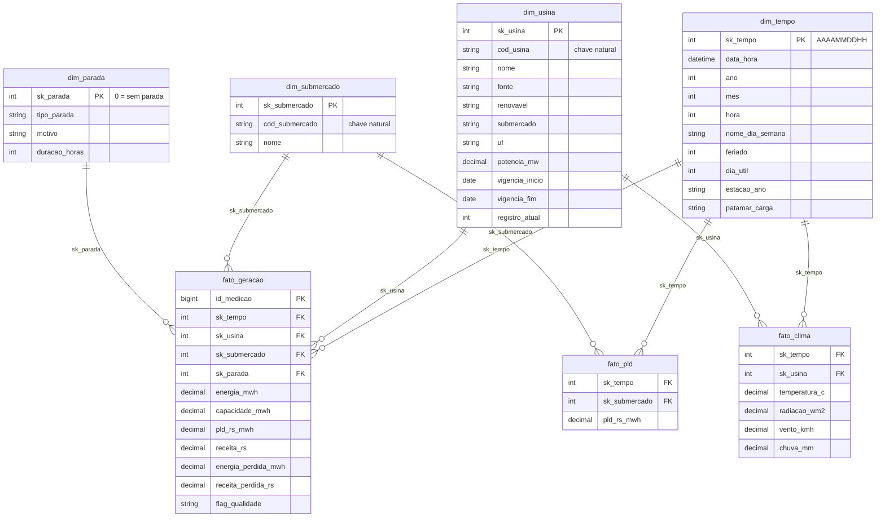

# Documento de modelagem

Data warehouse `dw_campo_real` (star schema). Scripts: `sql/04_dw_criar.sql`
(DDL) e `sql/05_dw_carga.sql` (carga).

## 1. Matriz de barramento

| Processo de negócio | Fato | Tempo | Usina | Submercado | Parada |
|---------------------|------|:-----:|:-----:|:----------:|:------:|
| Geração de energia | `fato_geracao` | X | X | X | X |
| Preço de mercado (PLD) | `fato_pld` | X |   | X |   |
| Clima no local da usina | `fato_clima` | X | X |   |   |

`dim_tempo` e `dim_submercado` são as dimensões compartilhadas: é por elas
que geração e preço "conversam".

## 2. Grão de cada fato

Definido antes de criar as tabelas:

| Fato | Grão | Medidas |
|------|------|---------|
| `fato_geracao` | 1 usina em 1 hora | energia (MWh), disponibilidade (MW), capacidade (MWh), PLD da hora, receita (R$), energia e receita não geradas |
| `fato_pld` | 1 submercado em 1 hora | PLD (R$/MWh) |
| `fato_clima` | 1 usina em 1 hora | temperatura, radiação solar, vento, chuva |

A tabela de origem `medicao_geracao` deveria ter o mesmo grão de
`fato_geracao`, mas não tinha chave única (havia horas duplicadas). No DW o
grão é garantido pela limpeza.

O grão da geração (usina x hora) e o do PLD (submercado x hora) **não são
iguais**. O preço é ligado à geração pela hora e pelo submercado da usina.

## 3. Diagrama do star schema



## 4. Decisões de modelagem

### Usina, fonte e submercado: uma dimensão ou três?

- **Fonte de energia ficou dentro da `dim_usina`.** Cada usina tem uma fonte
  só, então a fonte é um atributo da usina. Separar criaria um floco de neve
  (snowflake) sem ganho nenhum.
- **Submercado é uma dimensão separada** (`dim_submercado`), porque o
  `fato_pld` não tem usina: ele precisa do submercado sozinho. O nome do
  submercado também foi copiado para a `dim_usina` para facilitar os filtros.

### Chave natural x chave substituta

O fato guarda a **chave substituta** (`sk_usina`, `sk_submercado`). A chave
natural (`cod_usina`, `cod_submercado`) fica só na dimensão. Motivos: o código
de negócio pode mudar ou vir errado (como o cadastro `CRE-EOL-07`), e o SCD 2
precisa de mais de uma linha para a mesma usina.

Na `dim_tempo` a chave é o próprio momento no formato `AAAAMMDDHH`
(ex.: `2025091512`), que é fácil de ler e de conferir.

### Registros sem correspondência (membro desconhecido)

`dim_usina` e `dim_submercado` têm a linha **-1 = "Desconhecido"**. As 25
medições de usina nula ou sem cadastro entram no fato apontando para ela.
Assim nenhuma medição some, e o painel mostra quanto está sem dono. Como
não dá para saber o submercado, essas linhas ficam sem PLD e sem receita.

### Mudanças no cadastro (SCD)

Escolhemos **SCD tipo 2** para a `dim_usina` nos atributos nome, potência e
situação. A potência entra no cálculo do fator de capacidade: se a usina for
ampliada em 2026, a geração de 2025 precisa continuar sendo dividida pela
potência antiga. Com tipo 1 (sobrescrever) o histórico ficaria errado.

Como funciona: colunas `vigencia_inicio`, `vigencia_fim` e `registro_atual`.
Na carga inicial cada usina tem uma versão só. Quando houver mudança:

```sql
-- 1) fecha a versão atual
UPDATE dim_usina
   SET vigencia_fim = '2026-06-30', registro_atual = 0
 WHERE cod_usina = 'CRE-UFV-004' AND registro_atual = 1;

-- 2) insere a nova versão (nova sk_usina) com a potência nova
INSERT INTO dim_usina (cod_usina, nome, ..., potencia_mw, vigencia_inicio, vigencia_fim, registro_atual)
VALUES ('CRE-UFV-004', 'UFV Campo Real Minas', ..., 80.00, '2026-07-01', '9999-12-31', 1);
```

A carga do fato já procura a versão que valia na data da medição
(`DATE(data_hora) BETWEEN vigencia_inicio AND vigencia_fim`).

Para correção de erro de cadastro (latitude, UF) usamos tipo 1: é só
consertar, não é uma mudança de verdade.

### Horas de parada

A parada virou dimensão (`dim_parada`), com a linha **0 = "Sem parada"**.
Cada hora do `fato_geracao` aponta para a parada que estava acontecendo ou
para o 0. Nas horas paradas o fato guarda também a **estimativa do que
deixou de ser gerado**: a média da mesma usina, no mesmo mês e na mesma hora
do dia, nos dias sem parada. A receita não gerada é essa energia vezes o
PLD da hora.

Limitação: a biomassa ficou parada o mês de dezembro inteiro (entressafra),
então não há base de comparação e a estimativa é 0.

### Dimensão de tempo

Construída no `05_dw_carga.sql`, uma linha por hora de 2025 e 2026:

- **feriado**: 2025 vem da tabela `feriado_nacional`; 2026 foi listado no
  script, porque a origem só tem 2025. Ponto facultativo conta como feriado.
- **dia útil**: segunda a sexta que não é feriado.
- **estação do ano**: datas aproximadas do hemisfério sul.
- **patamar de carga** (regra simplificada):
  - dia útil: Leve 0h-6h, Média 7h-17h e 21h-23h, Pesada 18h-20h;
  - sábado, domingo e feriado: Leve 0h-16h e 22h-23h, Média 17h-21h.

### Granularidades diferentes

| Dado | Granularidade | Como entrou no modelo |
|------|---------------|-----------------------|
| Geração, PLD, clima | horária | fatos no grão de hora |
| Feriado | diária | atributo da `dim_tempo` (repetido nas 24 horas do dia) |
| Parada | intervalo (início e fim) | "aberta" hora a hora: cada hora do fato aponta para a parada |
| Usina, fonte, submercado | cadastral | dimensões |

### Fonte externa de clima (Open-Meteo)

Entrou como fato próprio (`fato_clima`), no grão usina x hora. A associação
do ponto de clima com a usina é direta: a API foi consultada **nas
coordenadas de cada usina**, então cada usina tem o seu ponto. Não foi
preciso escolher estação mais próxima nem fazer média por submercado.

## 5. Camadas de dados

| Camada | Onde | O que guarda |
|--------|------|--------------|
| Raw | `campo_real_energia.stg_pld_horario`, `raw_clima_openmeteo` | dado como chegou, com origem e data da extração |
| Tratada | `campo_real_energia.pld_horario`, `clima_horario` | tipos certos, chave definida |
| Limpa | `dw_campo_real.stg_medicao_limpa`, `stg_pld_limpo`, `quarentena_medicao` | resultado das regras de qualidade |
| Dimensional | `dw_campo_real.dim_*` e `fato_*` | o que o painel lê |
